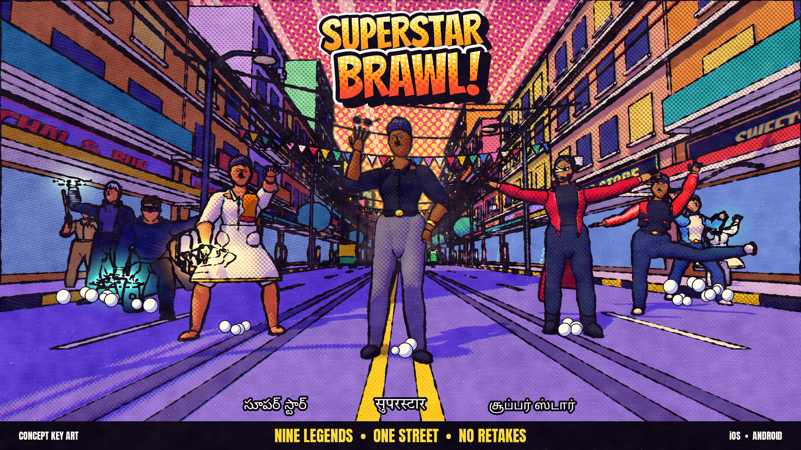
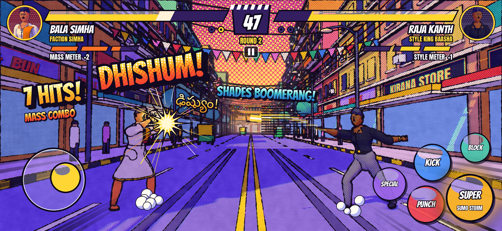
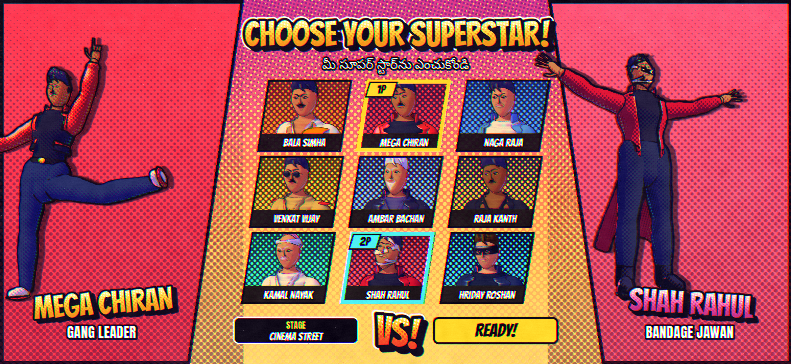
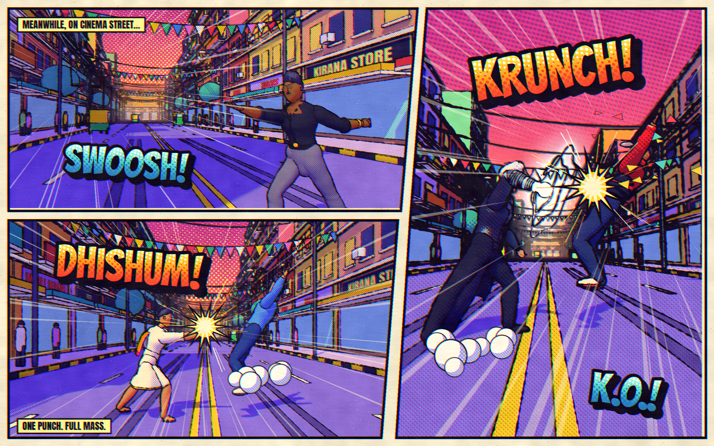
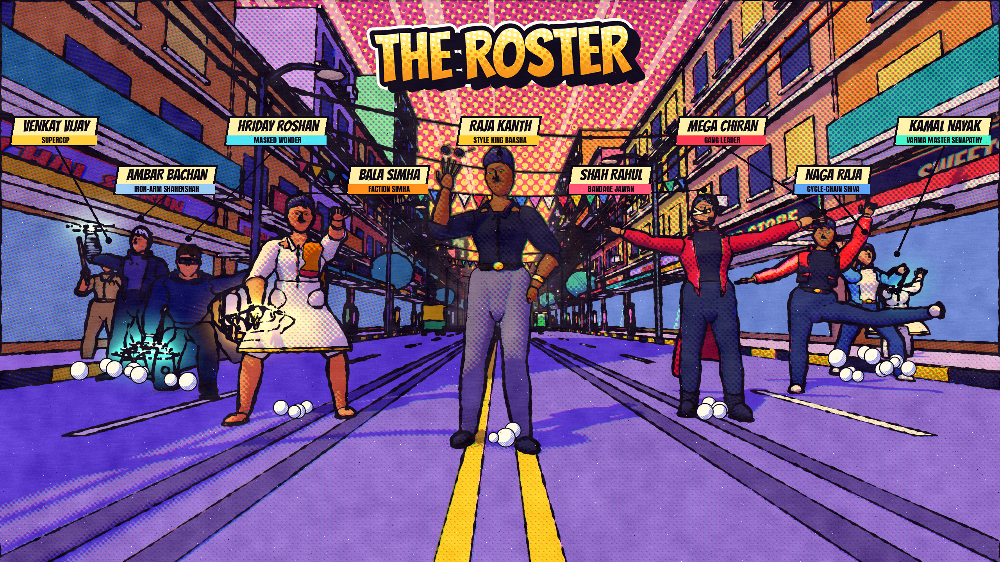
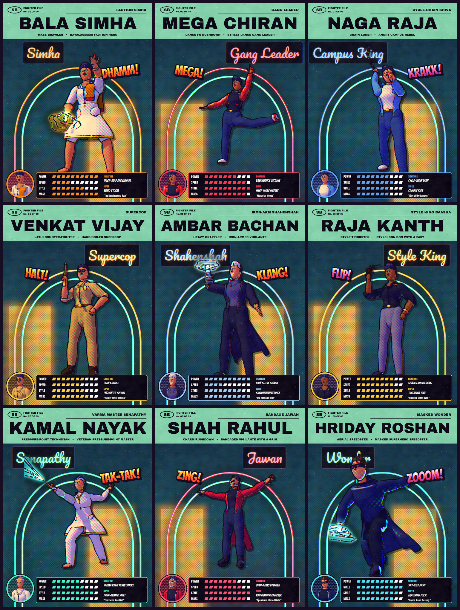
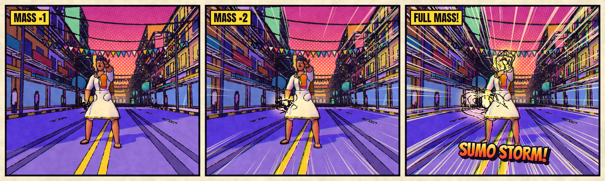
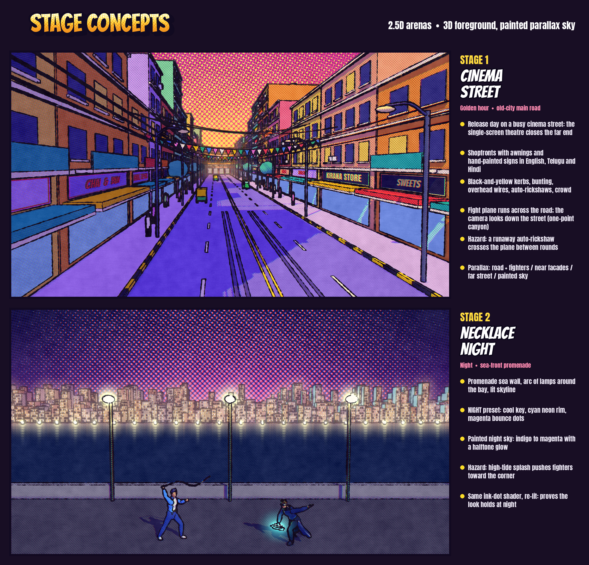
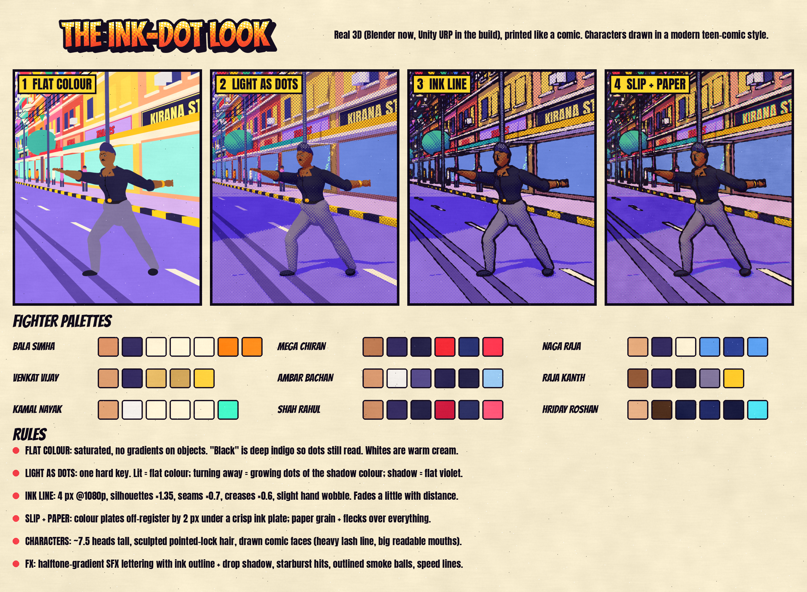

# Superstar Brawl

A 2.5D mobile fighting game (iOS and Android, Unity) where nine larger-than-life Indian-cinema superstar archetypes
brawl on a cinema street, drawn in a printed-comic "ink-dot" style with modern teen-comic character design.

**Status: concept-art phase (v2 look).** Every image below is generated with Blender (procedural 3D) plus a custom
comic shader and can be rebuilt from `art/pipeline/`.

| | |
|---|---|
|  |  |
|  |  |

## Concept boards (`art/concept/`)

| File | What it shows |
|------|---------------|
| `01_key_art.png` | Full roster on Cinema Street at sunset, title lockup |
| `02_roster_lineup.png` | Same shot with name / avatar captions |
| `03_card_XX_<id>.png`, `03_cards_sheet.png` | Fighter files in a comic-cover layout: hero pose on a neon backdrop, face roundel, stats, moves |
| `04_gameplay_mockup.png` | In-game 2.5D frame with the full mobile HUD and touch controls |
| `05_character_select.png` | Character-select screen |
| `06_action_panels.png` | Three-panel comic page of moves landing (SWOOSH / DHISHUM / KRUNCH) |
| `07_mass_meter.png` | Super-meter escalation: MASS ×1 / ×2 / FULL MASS |
| `08_stage1.png`, `08_stage2.png`, `08_stage_concepts.png` | Stage concepts with design notes |
| `09_style_guide.png` | The four-step look (flat colour → light as dots → ink line → slip + paper), palettes, rules |

## Docs

- [`docs/GAME_DESIGN.md`](docs/GAME_DESIGN.md): roster, systems, modes, stages, Unity tech plan
- [`docs/ART_BIBLE.md`](docs/ART_BIBLE.md): the ink-dot look, character style, Unity URP implementation plan
- [`docs/LEGAL_NOTE.md`](docs/LEGAL_NOTE.md): **likeness and personality rights; read before going public**
- [`art/pipeline/README.md`](art/pipeline/README.md): how to regenerate the art

Fonts in `art/fonts/` (Bangers, Anton, Archivo Black, Pacifico, Noto Sans Telugu, Noto Sans Tamil, Tiro Devanagari Hindi)
are from Google Fonts under the SIL Open Font License; licence files sit next to them.
