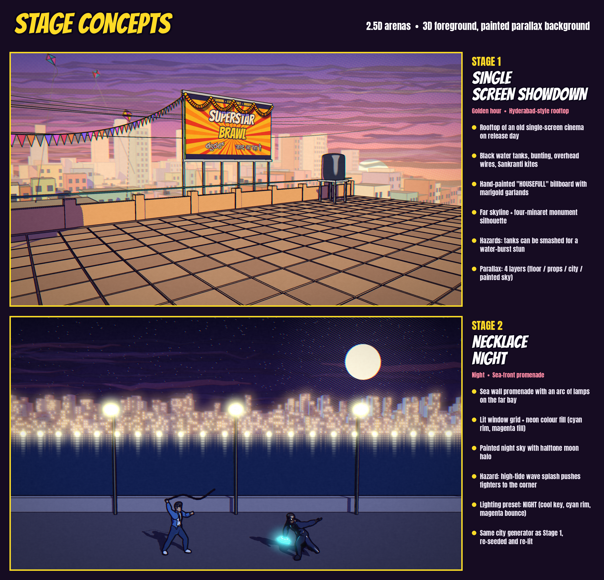
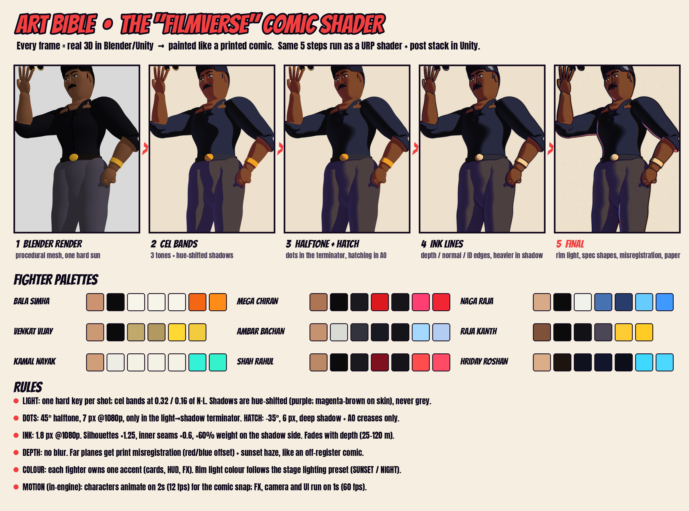

# Superstar Brawl

A 2.5D mobile fighting game (iOS and Android, Unity) where nine larger-than-life Indian-cinema superstar archetypes
brawl across a film-reel multiverse, drawn in a hand-printed comic-book style.

**Status: concept-art phase.** All of the art below was generated with Blender (procedural 3D) and a custom comic shader.
Every image can be rebuilt from `art/pipeline/`.

| | |
|---|---|
|  |  |
|  |  |

## Concept boards (`art/concept/`)

| File | What it shows |
|------|---------------|
| `01_key_art.png` | Full roster on the Stage 1 rooftop, title lockup |
| `02_roster_lineup.png` | Same shot with name / avatar callouts |
| `03_card_XX_<id>.png`, `03_cards_sheet.png` | Character cards: action pose, portrait inset, stats, signature and super moves |
| `04_gameplay_mockup.png` | In-game 2.5D frame with the full mobile HUD and touch controls |
| `05_character_select.png` | Character-select screen |
| `06_stage1.png`, `06_stage2.png`, `06_stage_concepts.png` | Stage concepts with design notes |
| `07_style_guide.png` | Art bible: shader breakdown, palettes, rules |

## Docs

- [`docs/GAME_DESIGN.md`](docs/GAME_DESIGN.md): roster, systems, modes, stages, Unity tech plan
- [`docs/ART_BIBLE.md`](docs/ART_BIBLE.md): the comic look, presets, Unity URP implementation plan
- [`docs/LEGAL_NOTE.md`](docs/LEGAL_NOTE.md): **likeness and personality rights; read before going public**
- [`art/pipeline/README.md`](art/pipeline/README.md): how to regenerate the art

Fonts in `art/fonts/` (Bangers, Anton, Noto Sans Telugu, Noto Sans Tamil, Tiro Devanagari Hindi) are from Google Fonts under the SIL Open Font License; licence files sit next to them.
